<!-- _class: lead -->

# Flights list redesign — UI research

**PLOUF-13** · project *Flights list redesign* · depth **Light** (per the Spec)
Accessed and written 2026-10-18 by Cyrus

<small>Screenshots of other products are in `refs/` (gitignored) and appear only in the PDF attached to PLOUF-13. Captures of Ploufbag are in `current/`. The option sketches in `sketches/` are low-fi illustrations of an idea, not designs.</small>

---

<!-- _class: dense -->

## Summary

**Studied:** 8 references. 3 are **same space** (XContest, DHV-XC, Strava Training Log & feed) and 5 are **borrowed paradigms**: the photo library timeline (Apple Photos, Google Photos), "Popular above the catalogue" (Spotify), dated episode lists (Apple Podcasts) and activity by month (GitHub). Ploufbag today is captured at both breakpoints. *Light* asks for 3–5 references; Podcasts, GitHub and Google Photos are kept to one shared slide.

**Recommended direction:** a season of flying, read month by month.
- **Month** headings that carry a summary (`July 2026 · 11 flights · 16 h`).
- Standouts set by **one airtime threshold** (provisionally 2 h 30), **marked in the row**.
- **Older months collapse** to show only their standouts, with a "show all" link. This is how 1,000+ flights stay browsable.
- Rows lead with the **route**, use **airtime** as the right-hand scan value, and the date moves into the heading.

**Decisions needed (4):**
- **D-1** time period
- **D-2** standout rule
- **D-3** standout treatment
- **D-4** row hierarchy

There are also 3 suggested spec changes.

---

<!-- _class: dense -->

## D-1 · How should flights be grouped in time? (AC 1, 2)

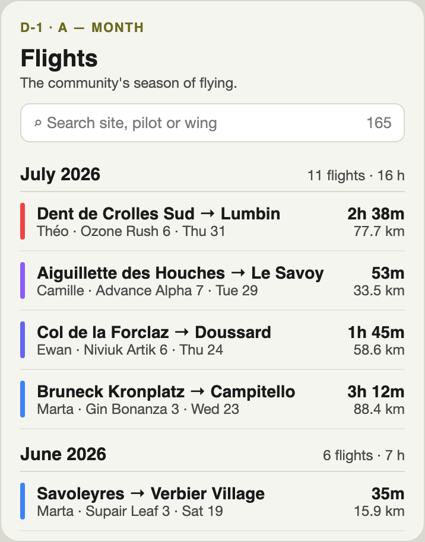
**A — Month** (recommended)
Like Strava's month recaps, GitHub's month dividers and Apple Photos *Months*.
✅ About 20 groups for the seed's 21 months, with sizes that follow the season.
⚠️ A busy summer month runs long.

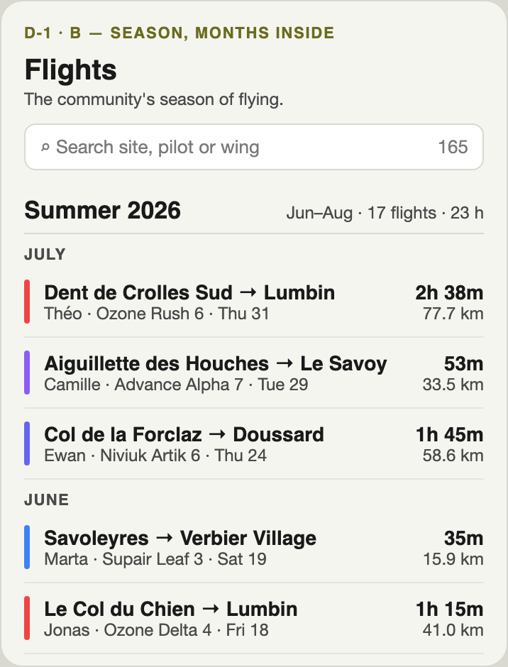
**B — Season, with months inside**
Meteorological seasons (AC 1).
✅ Reads strongly as "a season of flying".
⚠️ 40–100+ flights under one heading. Two heading levels on a 390 px sheet.

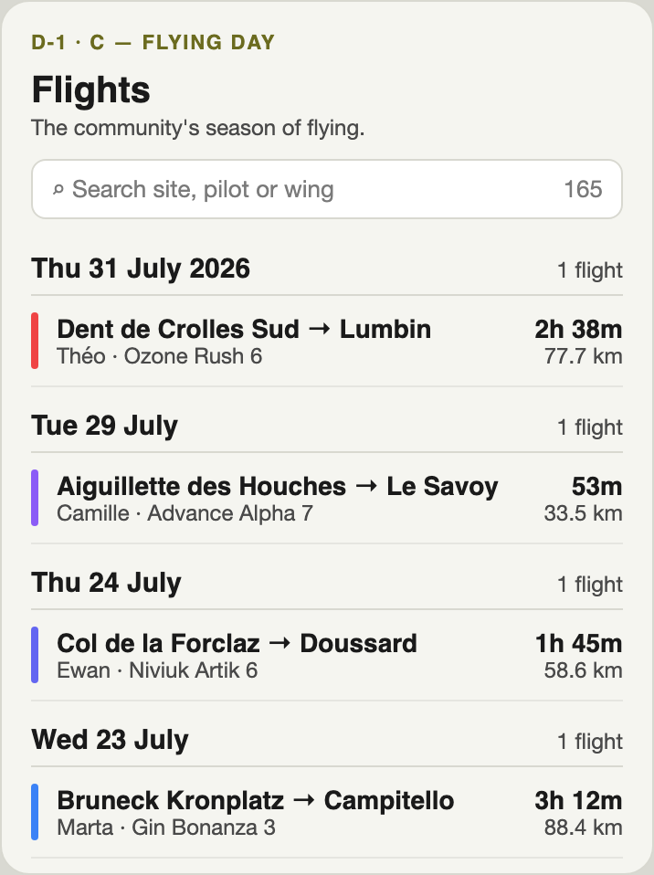
**C — Flying day**
Like XContest daily pages and DHV-XC's per-day date.
✅ "A good day at Annecy" makes a story.
⚠️ The seed has 146 distinct days for 165 flights, so most headings would cover one flight.

<small>**Recommendation: A.** Month is the coarsest period that still shows rhythm, and its heading can carry a summary. What would change it: production data that clusters into a few big flying days, which would favour C.</small>

---

<!-- _class: dense -->

## D-2 · What makes a flight a standout? (AC 3, 16)

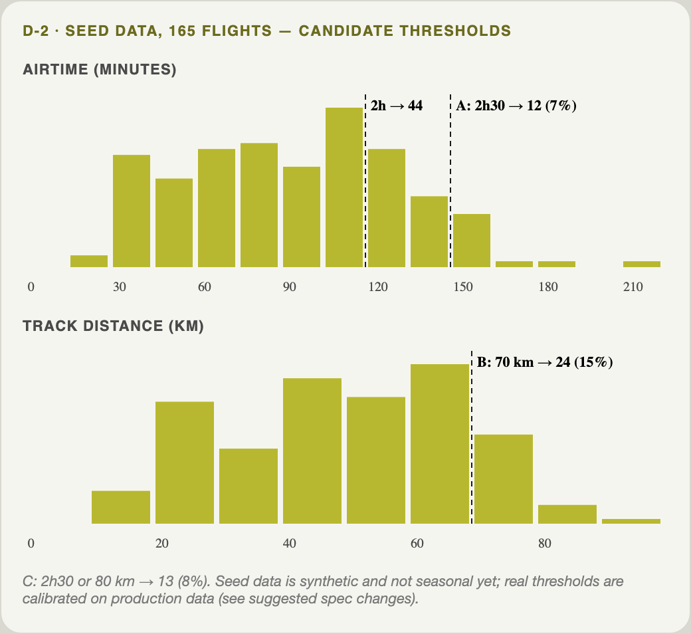

**A — Airtime ≥ 2 h 30** (recommended): 12 of 165 seed flights (7%).
✅ It's the number pilots brag about. It explains itself in a tag ("2h30+"). It's robust.
⚠️ A fast long glide can score less than a slow soaring flight.

**B — Track distance ≥ 70 km**: 24 / 165 (15%).
⚠️ Strava distance is *track length*, including every thermal circle, so it rewards circling, not going somewhere.

**C — Airtime ≥ 2 h 30 or distance ≥ 80 km**: 13 / 165 (8%).
⚠️ Two numbers to explain. Here it adds one flight to A.

<small>All options are absolute (review Q7) and come from existing fields. The seed is synthetic and not yet seasonal (AC 22), so the threshold must be **calibrated on production data**, aiming for about 5–10% of flights. See suggested spec change S-1.</small>

---

<!-- _class: dense -->

## D-3 · How is a standout shown? (AC 3, 11, 20)

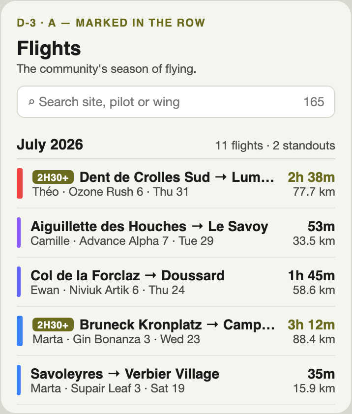
**A — Marked in the row**
A tag, a thicker colour bar, and airtime in the primary colour.
✅ Simple. Order is kept. One row per flight.
⚠️ Doesn't help at 1,000+ flights.

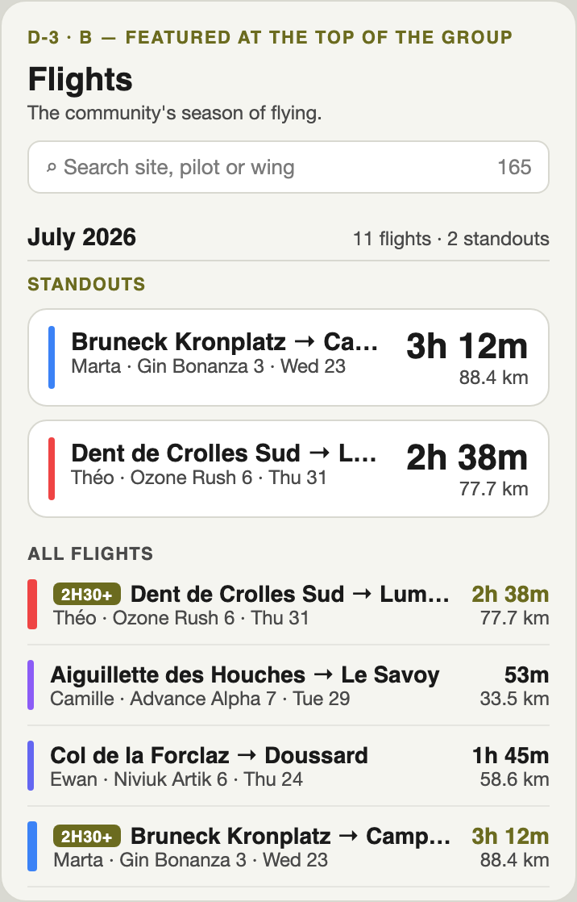
**B — Featured block per group**
Spotify's *Popular* above the catalogue.
✅ The most showcase-like.
⚠️ The flight appears twice, so hover↔track and keyboard order get ambiguous. It costs height on mobile.

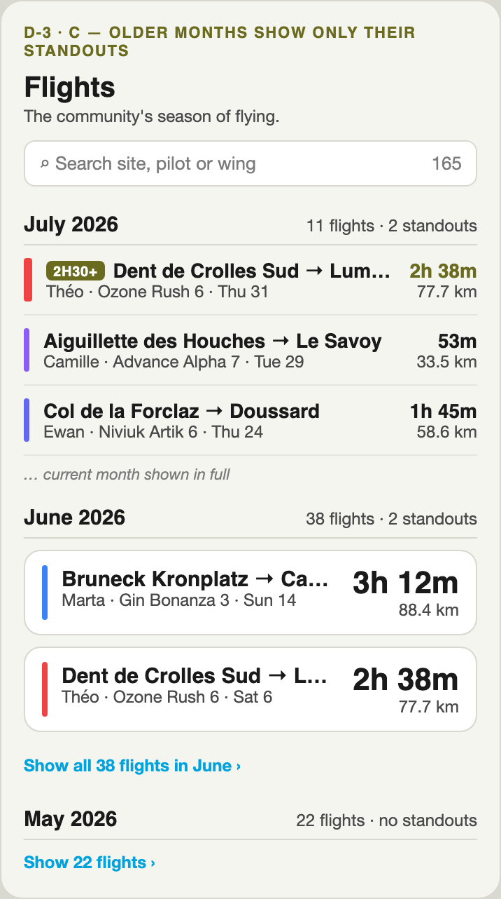
**C — A + older months collapsed to their standouts** (recommended)
Apple Photos: the coarse view shows the best, *All* shows everything.
✅ Answers AC 11 scale. Each flight appears once.
⚠️ Hidden rows need an AC 20 behaviour. More states to design.

<small>**Recommendation: C.** The newest month is open, and every group is open during a search. Older months show their standouts and a "Show all N flights" link. What would change it: if a fully open list is preferred, choose A and handle scale with progressive loading.</small>

---

<!-- _class: dense -->

## D-4 · What does a row lead with? (AC 4, 5, 9)

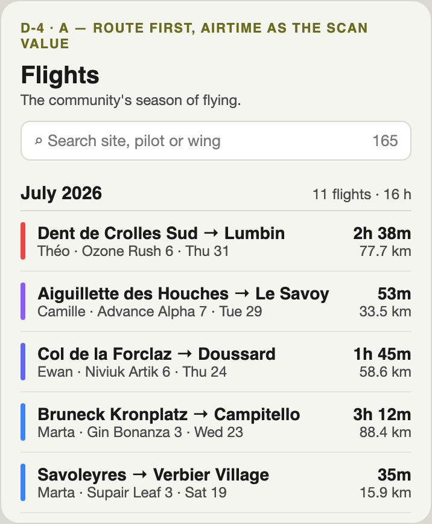
**A — Route first, airtime on the right** (recommended)
Today's order, simplified.
✅ Visitors recognise places before people. The right column is one scan value.
⚠️ Long site names still truncate.

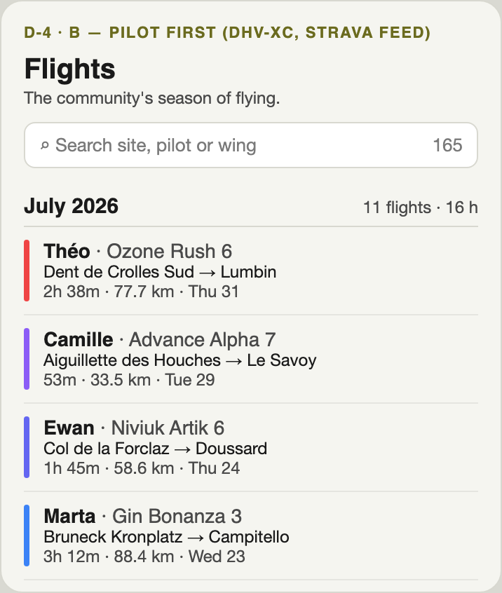
**B — Pilot first**
DHV-XC mobile cards, the Strava feed.
✅ Feels social.
⚠️ The primary visitor doesn't know the pilots. It's three lines tall.

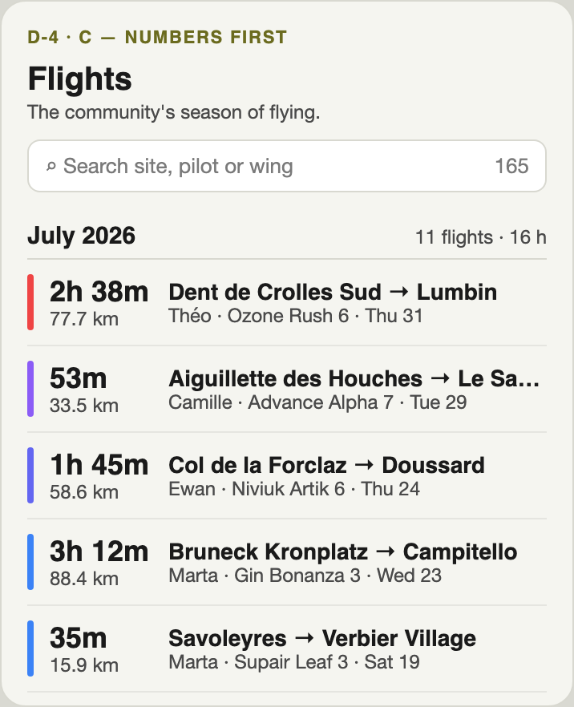
**C — Numbers first**
Airtime and km lead on the left.
✅ The standout measure is scanned first.
⚠️ It reads as a table. Route loses width on 390 px.

<small>**In every option:** the date leaves the right column. The heading gives the month and the row keeps `Thu 31`, so AC 4 is still met. Description stays out of the row. Pilot, wing and sites remain links (AC 9) without dotted underlines at rest. **Recommendation: A.**</small>

---

## The problem and the tasks (from the Spec)

**Problems**
1. **Hard to scan.** Every row has the same weight and the same dense layout.
2. **No sense of time.** One unbroken column, with no day, month or season.
3. **Nothing stands out.** A 3 h cross-country looks like a 10-min hop.

**Primary user:** a logged-out visitor, mobile first (390 px, bottom sheet), desktop 1440 equally.

**Tasks to make quick**
- See *when* the flights in view happened, and move through time.
- Tell remarkable flights from routine ones without opening them.
- Read takeoff, landing and how long or far in one look.
- Search a site, pilot or wing and see matches, still grouped.
- Keep the list and the map as one thing: row ↔ track hover, colour cue.

**Data:** only the existing fields (non-goal). Grouping and standouts are client-side, with time in Europe/Paris.

---

## Ploufbag today

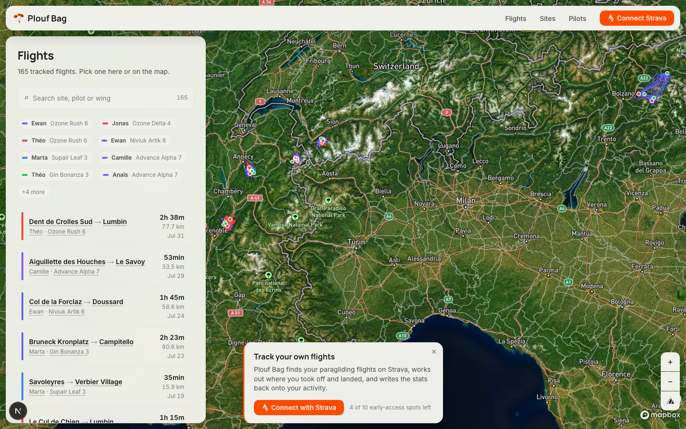

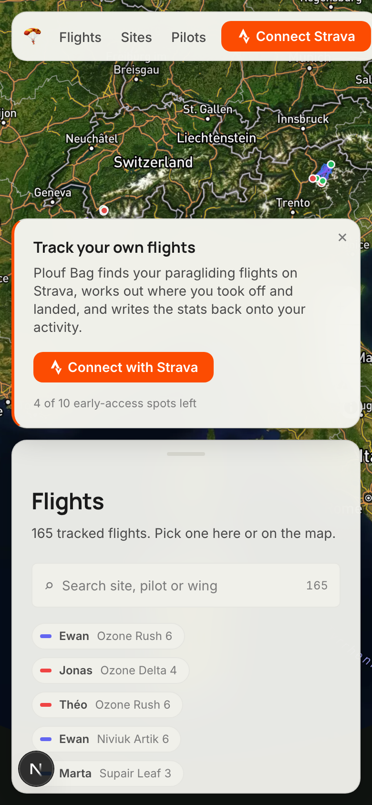 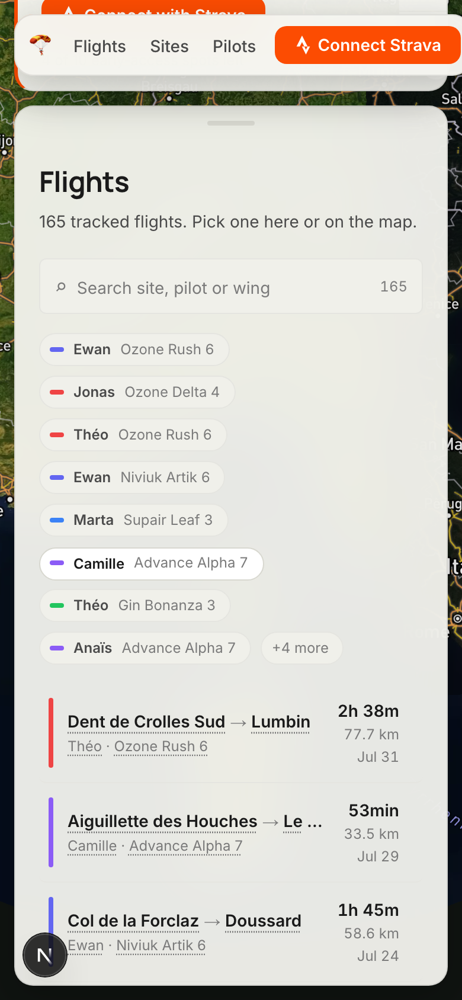

<small>Desktop, mobile at the default (half) sheet, and mobile at full sheet. Mobile at default shows **no flight rows**: the signup card and 8 legend chips fill the sheet. At full height about 2.5 rows show. Each row is about 84 px.</small>

---

## Ploufbag today — anatomy and score

- **Header:** "Flights" and "165 tracked flights. Pick one here or on the map."
- **Search:** site, pilot first name, wing. The count shows "165" or "9 of 165", announced through `aria-live`.
- **Legend chips:** one per pilot+wing, 8 then "+N more". A click searches for that pilot.
- **Row:** a 4 px colour bar · **Takeoff → Landing** (14 px semibold) · `Pilot · Wing` (12 px muted) · right column: **duration**, km, `Jul 31` *with no year*. There are four dotted-underline links.
- **Order:** `start_date desc`, flat, with no paging.
- **Row colour:** `FlightRow` ignores `wing_colour` but the legend uses it, so the colours can differ (AC 17).

| Rubric | Score |
|---|---|
| Core task & steps | 3 — search works, no time structure |
| Density & hierarchy | 3 — clear rows, all equal, tall |
| Navigation & wayfinding | 4 — everything links, current row shown |
| Map & track | 4 — two-way hover, legend filter |
| Mobile ergonomics | 2 — no rows at default height, truncation |
| Empty / loading / error | 3 — copy for no match, no skeleton |
| Onboarding / first use | 3 — subtitle helps, colours unexplained |
| Accessibility | 3 — good ARIA; muted #7a7a7a ≈ 4:1, small links |

<small>Library (`design/library.lib.pen`): `List Item / Flight` (+ `Current`), `Section Title`, `Panel Header`, `Search Field`, `Chip / Legend`, `Badge / Count`, `Tag / Label`, `Empty State`, `Loading Skeleton`, `Panel / Sheet Mobile`. **There's no group-heading component yet**; `Section Title` is the nearest.</small>

---

<!-- _class: dense -->

## Ploufbag today — the row on other pages (AC 18)

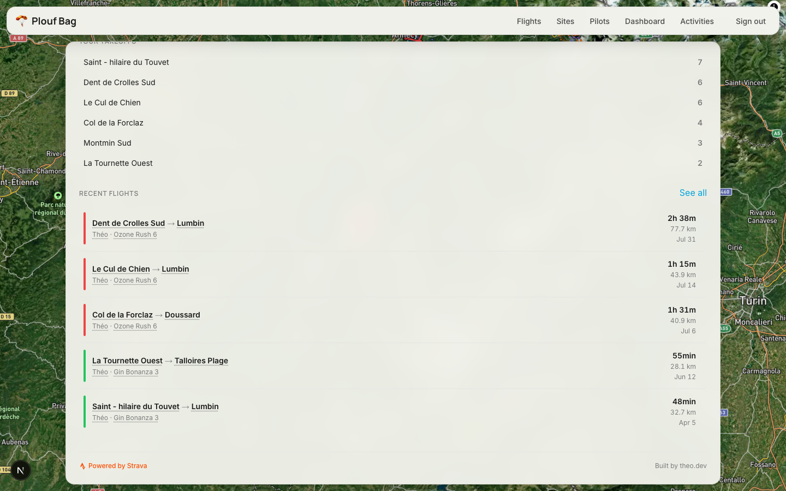

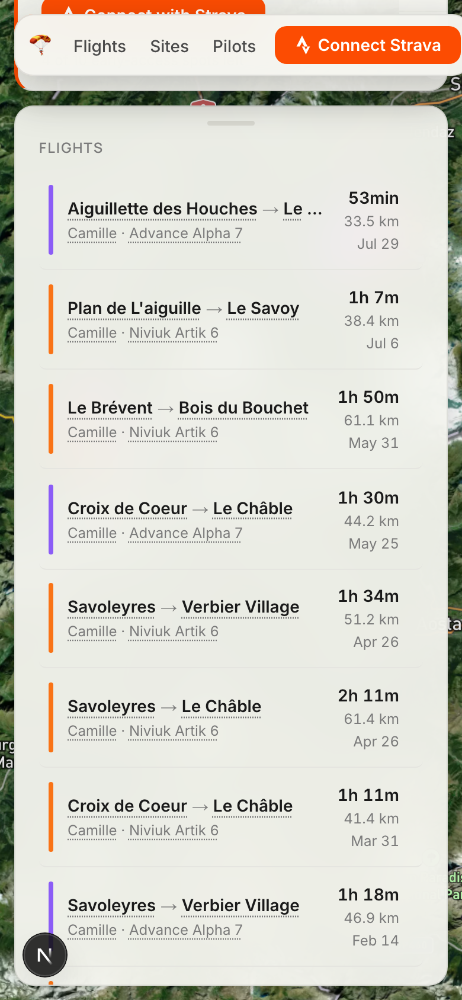

<small>`/dashboard` "Recent flights" (5 rows plus "See all") and `/pilots/[id]` "Flights". They use the same `FlightRow`, so the new row lands here too, without grouping or standouts. Also captured: `current/dashboard--desktop.png`, `current/pilot--mobile.png`, `current/flights--desktop-search.png` (search "forclaz", 9 of 165).</small>

---

<!-- _class: dense -->

## Reference — XContest · same space · **seen**

**What it does:** "Registered flights" is a table, newest first. Each row has 11 equal columns: number, start time, pilot, launch, route, length, points, airtime, glider logo, info, map. A *daily score* page ranks one day by points. The season rolls over in autumn ("XContest 2027" on 18 Oct). Mobile is the desktop table shrunk.

| Core | Density | Wayfind | Map | Mobile | States | Onboard | A11y |
|---|---|---|---|---|---|---|---|
| 3 | 1 | 3 | 2 | 1 | n/a | 2 | 1 |

**Do:** treat the day as a unit for highlights; give the headline number its own type.
**Avoid:** full timestamps on every row; brand logos as the loudest element; tables on phones; ~9 px text.

**For Ploufbag:** borrow "a period has its best flights" (D-2, D-3), not the table. For our small community, the season is too coarse as the only grouping.

---

<!-- _class: dense -->

## Reference — DHV-XC · same space · **seen**

 

**What it does:** paged 20 at a time out of 11,762. On desktop the date is printed only on the first row of each day, so days are grouped implicitly. On mobile the cards have pilot in bold, then takeoff, distance, speed, a `10:35 → 17:31` time range and airtime in orange, with the date muted on every card. A green "New" badge appears on every row.

| Core | Density | Wayfind | Map | Mobile | States | Onboard | A11y |
|---|---|---|---|---|---|---|---|
| 3 | 3 | 2 | 1 | 3 | n/a | 2 | 3 |

**Do:** a real primary line; muted secondary data; one stats line; the time range as a cue for a long day.
**Avoid:** a badge on every row (it marks nothing); blank date cells as the only day separator; numbered paging through thousands.

**For Ploufbag:** the card anatomy for D-4 (option B is its pilot-first form). Lift the date into group headings. Use incremental scrolling or collapsed months instead of pages.

---

<!-- _class: dense -->

## Reference — Strava Training Log & feed · same space · **marketing**

**What it does** (Strava's own images and support text; the logged-in screens weren't seen):
- The web log shows **a week per row**, with a total per week ("Total Time 5h 37m"). Bubbles are sized by time, distance or elevation. "Rest" marks an empty day.
- On mobile, a week strip and **month recap cards**.
- Feed cards go who · when ("Today at 8:05 AM") → title → media, with stats small.

| Core | Density | Wayfind | Map | Mobile | States | Onboard | A11y |
|---|---|---|---|---|---|---|---|
| 4 | 4 | 4 | 3 | 3 | 3 | n/a | 2 |

**Do:** a group heading that carries a summary; emphasis scaled to an objective metric; a named empty period.
**Avoid:** labels inside shapes that shrink with the value (clipped "10:32"); colour as the only cue.

**For Ploufbag:** `July 2026 · 11 flights · 16 h` as the heading (D-1). Emphasis as a tag and row weight, not size-scaled shapes (D-3).

---

<!-- _class: dense -->

## Reference — Apple Photos Years / Months / All · borrowed paradigm · **marketing**

**Paradigm:** the same library at several time zooms. Coarse zooms show *a summary of the best*; "All Photos" shows everything. (From Apple's user guide, text plus one screenshot; the app wasn't opened.)

| Core | Density | Wayfind | Map | Mobile | States | Onboard | A11y |
|---|---|---|---|---|---|---|---|
| 4 | 4 | 5 | n/a | n/a | n/a | n/a | n/a |

**Do:** a time zoom you can see; let the coarse view hold the standouts and the fine view hold everything.
**Avoid:** opaque "best" curation. A community log needs a rule people can check (review Q7).

**Translation to Ploufbag:** older months collapse to **their standouts plus "Show all N flights"**, and the newest month and any search results are fully open. That is D-3 option C. It turns 1,000+ flights into about 20 headings with a few rows each.

---

<!-- _class: dense -->

## Reference — Spotify artist page · borrowed paradigm · **seen**

 

**Paradigm:** a short, capped **"Popular"** list (5 tracks, showing the play count it's ranked by) above the full catalogue sections. Rows are two lines: the title is primary and large, with one muted secondary line. Mobile drops duration to stay at two lines.

| Core | Density | Wayfind | Map | Mobile | States | Onboard | A11y |
|---|---|---|---|---|---|---|---|
| 5 | 5 | 3 | n/a | 4 | n/a | 3 | 4 |

**Do:** a capped standout block that shows *why* (its value); two-line rows with one bold primary.
**Avoid:** horizontal carousels for the main list in a narrow panel; ranking by popularity (we have no such data).

**Translation to Ploufbag:** a *Standouts* block per month (D-3 B), each card showing its airtime. Its cost here is that a flight appears twice next to a map that highlights one track per row. The two-line row informs D-4 A.

---

<!-- _class: dense -->

## Supporting references · borrowed paradigms

**Apple Podcasts show page · seen.** A reverse-chronological list. Each row has a date eyebrow, relative then absolute ("3h ago" … "Oct 11"), and duration as a pill. There are no groups; 2.8K episodes sit behind "See All".
Scores 4 / 3 / 2 / n/a / 3 / n/a / 3 / 4.
→ *Today / Yesterday* wording for recent days. Keep the description out of the row.

**GitHub activity · seen.** A year heatmap, a year list on the side, and activity grouped under month dividers with a summary line.
Scores 4 / 4 / 5 / n/a / n/a / n/a / n/a / 2.
→ Month headings with a summary. A density strip is parked (see *Explored and rejected*).

**Google Photos · marketing + inferred.** Google's help text says the map and grid filter each other ("photos … in the visible map area"), and the day in focus drives the path on the map. The date scrubber that shows years while dragged is *inferred* from Android Police; its page was blocked, so it wasn't seen.
Scores n/a / n/a / 4 / 4 / n/a / n/a / n/a / n/a.
→ The heading in focus could highlight its month's tracks on the map. A later idea, outside this spec (the map is a non-goal).

<small>Score order: core · density · wayfinding · map · mobile · states · onboarding · a11y.</small>

---

<!-- _class: dense -->

## Rubric at a glance

| | Kind | Evidence | Core | Density | Wayfind | Map | Mobile | States | Onboard | A11y |
|---|---|---|---|---|---|---|---|---|---|---|
| **Ploufbag today** | — | seen | 3 | 3 | 4 | 4 | 2 | 3 | 3 | 3 |
| XContest | same space | seen | 3 | 1 | 3 | 2 | 1 | n/a | 2 | 1 |
| DHV-XC | same space | seen | 3 | 3 | 2 | 1 | 3 | n/a | 2 | 3 |
| Strava log & feed | same space | marketing | 4 | 4 | 4 | 3 | 3 | 3 | n/a | 2 |
| Apple Photos | borrowed | marketing | 4 | 4 | 5 | n/a | n/a | n/a | n/a | n/a |
| Spotify artist | borrowed | seen | 5 | 5 | 3 | n/a | 4 | n/a | 3 | 4 |
| Apple Podcasts | borrowed | seen | 4 | 3 | 2 | n/a | 3 | n/a | 3 | 4 |
| GitHub activity | borrowed | seen | 4 | 4 | 5 | n/a | n/a | n/a | n/a | 2 |
| Google Photos | borrowed | marketing + inferred | n/a | n/a | 4 | 4 | n/a | n/a | n/a | n/a |

<small>Scores run 1–5; n/a means not observed. No reference was seen in an empty, loading or error state, so those states have no outside model: design them from the library's `Empty State` and `Loading Skeleton`.

Same-space products are weak where Ploufbag is already strong (the map link) and strong only on one axis each. The best hierarchy and wayfinding come from outside the space.</small>

---

## Patterns — what works across the references

1. **The heading carries the time and a summary**, so rows don't repeat the date. Seen in Strava's week totals, GitHub's month summaries, and DHV-XC's date-once on desktop.
2. **Group by the coarsest period that still shows rhythm.** Month for a small community (Strava recaps, GitHub, Apple Photos *Months*). Day only when days are full (XContest, DHV-XC with thousands of pilots).
3. **Standouts say why they stand out**: the value they were picked by sits next to them (Spotify play counts, XContest points, Strava bubble size).
4. **Curated at the coarse level, complete at the fine level.** Older periods show their best and open on demand (Apple Photos, Spotify "Show all").
5. **Two text tiers per row**: one bold primary, one muted secondary, and a single right-aligned scan value (Spotify, DHV-XC mobile, Podcasts' duration pill).
6. **Emphasis isn't colour alone**: a tag or weight goes alongside colour (the opposite of GitHub and Strava, which rely on colour).

---

## Avoid — poor solutions seen elsewhere

- **A desktop table shrunk onto a phone.** XContest at 390 px is unreadable.
- **A badge on every row.** DHV-XC's "New" marks everything, so it marks nothing. A standout rule that flags 30% of flights does the same.
- **Full date and time repeated on every row** when a heading could carry it (XContest, DHV-XC mobile, Podcasts).
- **Labels inside shapes that scale with the value** (Strava's clipped "10:32").
- **Colour-only intensity in tiny targets** (GitHub's ~10 px heatmap cells).
- **Numbered paging through thousands** (DHV-XC, 20 per page): it breaks scroll restore (AC 19) and the map link.
- **Opaque "best of" curation** (Apple Photos): fine for photos, wrong for a community log.
- **Banners, login walls and floating players over the list** (Leonardo login wall, DHV-XC notice, Podcasts and Spotify on mobile). Ploufbag's own signup card does this to the mobile sheet today.
- **Brand or sponsor logos louder than the data** (XContest's glider column).

---

## Explored and rejected

- **Points or score ranking** (XContest, DHV-XC): needs data we don't have, which is a non-goal.
- **"Best of the month"** relative ranking: ruled out by review Q7. A quiet month must not invent a standout.
- **Two standout tiers** ("good" and "epic"): twice the rules to explain and verify (AC 16), and more noise.
- **"Landed somewhere else" as a cross-country signal:** all 165 seed flights already have takeoff ≠ landing, because landing fields are separate sites.
- **Standouts from the description** (keywords, length): it's AI-generated text, so the result is neither deterministic nor fair.
- **Size-scaled marks** (Strava bubbles): clipping, contrast, and no room in a 390 px row.
- **A horizontal carousel of featured flights:** hides content in a narrow panel, and the Spotify pattern shows it reads as secondary.
- **Numbered pages:** see Avoid.
- **A scrubber or month-density strip** to jump through time (Google Photos, GitHub): parked, not rejected on merit. Review Q9 rejected a "move through time" criterion, and collapsed months already reduce 1,000 flights to about 20 headings. Revisit when real data spans several seasons.
- **A pilot-first row** is offered as D-4 B but not recommended: the primary user knows no pilots.

---

## Suggested spec changes

**S-1 · Calibrate the standout threshold on production data (AC 3, 16).** The seed is synthetic, so any threshold set on it is arbitrary. Agents have no production access. *Proposal:* add a `[Human]` step in the Designed milestone. Theo runs a read-only count of production flights at ≥ 2 h, 2 h 30 and 3 h, and at ≥ 50, 70 and 100 km. The rule in *Design Decisions* uses the threshold that marks about 5–10% of flights.

**S-2 · Say whether AC 12's contrast fix may change the site-wide muted colour.** `--color-text-muted` (#7a7a7a) on the panel is about 4:1, below AA for 12 px text, and it's used site-wide. *Proposal:* allow the list to use the secondary text colour (#4a4a4a) for its secondary tier. Leave the token unchanged in this project.

**S-3 · Make the default mobile sheet show the list (AC 10, 13).** At the default (half) height, a logged-out visitor sees the signup card and legend chips and **no flights**. *Proposal:* add a criterion that at the default sheet height the first group heading and at least one row are visible. Decide whether the signup card's placement is in scope or a separate issue.

---

<!-- _class: dense -->

## Sources (all accessed 2026-10-18)

| Reference | Evidence | URL |
|---|---|---|
| XContest flights | seen | https://www.xcontest.org/world/en/flights/ |
| XContest daily score | seen | https://www.xcontest.org/2026/world/en/flights/daily-score-pg/ |
| DHV-XC flights | seen | https://en.dhv-xc.de/flights |
| Leonardo (login wall only) | seen | https://www.paraglidingforum.com/leonardo/ |
| Strava Training Log help | marketing | https://support.strava.com/en-us/articles/15402077-training-log |
| Strava Training Log spotlight (staff post) | marketing | https://communityhub.strava.com/insider-journal-9/spotlight-on-the-training-log-1497 |
| Strava App Store listing | marketing | https://apps.apple.com/us/app/strava-run-bike-walk/id426826309 |
| Apple Photos user guide | marketing | https://support.apple.com/guide/photos/find-photos-and-videos-by-date-pht56eafa987/mac |
| Google Photos locations help | marketing | https://support.google.com/photos/answer/6153599 |
| Google Photos scrubber (Android Police) | inferred | https://www.androidpolice.com/google-photos-search-date-lost-images/ |
| Spotify artist page | seen | https://open.spotify.com/artist/4Z8W4fKeB5YxbusRsdQVPb |
| Apple Podcasts show page | seen | https://podcasts.apple.com/us/podcast/the-daily/id1200361736 |
| GitHub profile activity | seen | https://github.com/torvalds |
| Ploufbag (local dev, seed data) | seen | `node dev/capture.mjs --path /flights …` → `current/` |

<small>Seed statistics come from the dev database (`dev/db.sh up`, 165 flights, Nov 2024 – Jul 2026).</small>
